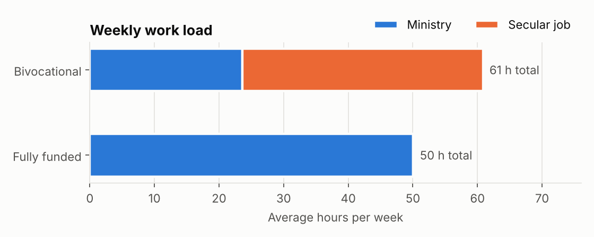
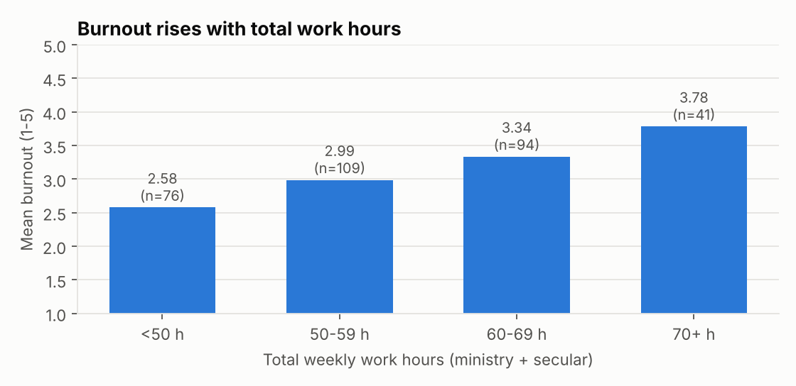
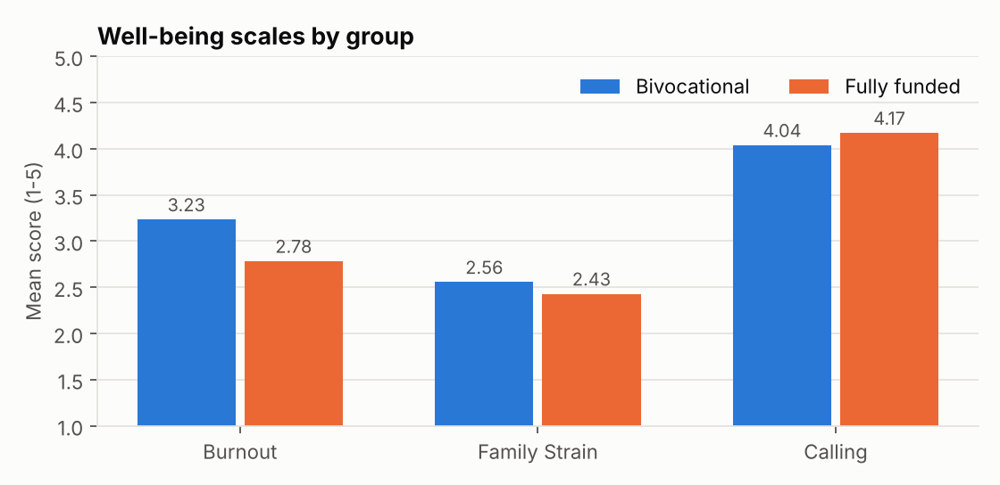
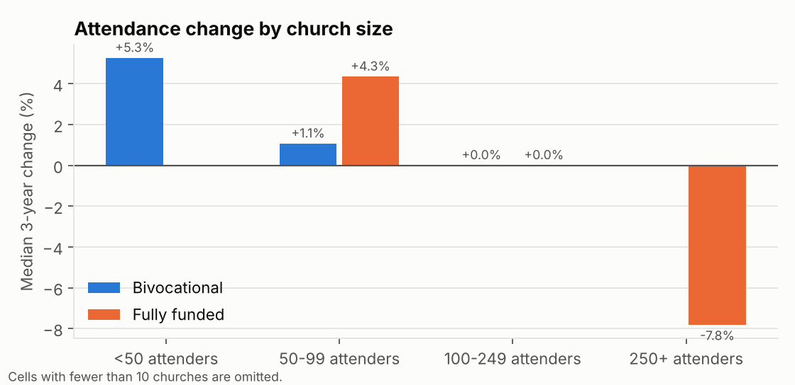
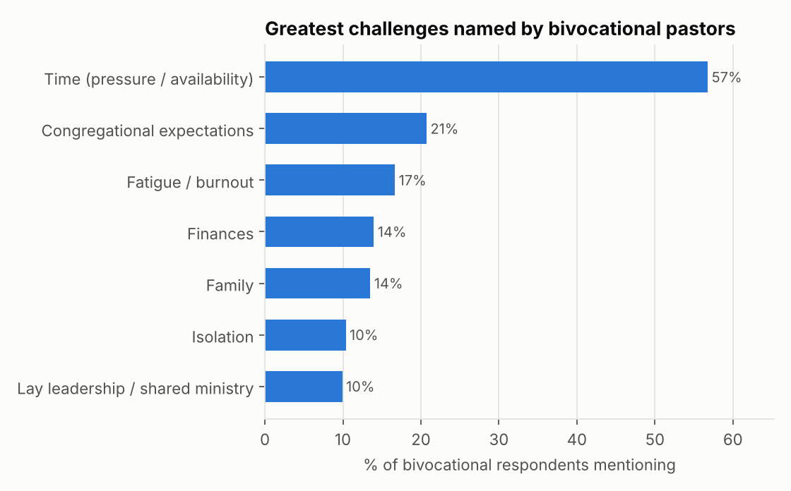

# Bivocational Ministry Survey - Results

Data: `sample_bivocational_survey.csv` - 320 respondents.

> **Synthetic sample data.** These numbers are made up for testing; rerun with `--data` on your real survey.

## Scale reliability

Cronbach's alpha ≥ 0.70 is usually considered acceptable.

| scale         |   items |   cronbach_alpha |
|:--------------|--------:|-----------------:|
| burnout       |       5 |            0.786 |
| family_strain |       3 |            0.649 |
| calling       |       3 |            0.399 |

## Q1. Who responded?

**Group sizes**

| group        |   n |   percent |   mean_age |   mean_years_in_ministry |   median_attendance |   pct_female |
|:-------------|----:|----------:|-----------:|-------------------------:|--------------------:|-------------:|
| Bivocational | 222 |      69.4 |       51.7 |                     20.7 |                57   |         23   |
| Fully funded |  98 |      30.6 |       51.2 |                     20.1 |               139.5 |         17.3 |

**Region (% of group)**

| region     |   Bivocational |   Fully funded |
|:-----------|---------------:|---------------:|
| rural      |           42.3 |            9.2 |
| small_town |           27   |           15.3 |
| suburban   |           15.3 |           44.9 |
| urban      |           15.3 |           30.6 |

**Reason for bivocational ministry**

| bivo_reason         |   percent of bivocational |
|:--------------------|--------------------------:|
| financial_necessity |                      45.5 |
| both                |                      28.8 |
| missional_choice    |                      25.7 |

**Secular job sector (bivocational)**

| secular_job_sector   |   n |
|:---------------------|----:|
| public_service       |  39 |
| education            |  33 |
| business_sales       |  31 |
| trades_construction  |  29 |
| self_employed        |  27 |
| healthcare           |  23 |
| agriculture          |  21 |
| other                |  19 |

## Q2. How heavy is the weekly work load?

**Weekly hours by group**

| group        |   ministry_hours |   secular_hours |   total_hours |   pct_over_60h |   church_income_pct |
|:-------------|-----------------:|----------------:|--------------:|---------------:|--------------------:|
| Bivocational |             23.6 |            37.2 |          60.9 |           55.9 |                29.5 |
| Fully funded |             50.1 |             0   |          50.1 |           11.2 |                96.6 |

## Q3. Do bivocational and fully funded pastors differ in well-being?

**Well-being by group**

| group        |   ('burnout', 'mean') |   ('burnout', 'std') |   ('burnout', 'count') |   ('family_strain', 'mean') |   ('family_strain', 'std') |   ('family_strain', 'count') |   ('calling', 'mean') |   ('calling', 'std') |   ('calling', 'count') |   ('ministry_satisfaction', 'mean') |   ('ministry_satisfaction', 'std') |   ('ministry_satisfaction', 'count') |
|:-------------|----------------------:|---------------------:|-----------------------:|----------------------------:|---------------------------:|-----------------------------:|----------------------:|---------------------:|-----------------------:|------------------------------------:|-----------------------------------:|-------------------------------------:|
| Bivocational |                  3.23 |                 0.81 |                    222 |                        2.56 |                        0.8 |                          222 |                  4.04 |                 0.54 |                    222 |                                5.8  |                               1.51 |                                  217 |
| Fully funded |                  2.78 |                 0.65 |                     98 |                        2.43 |                        0.8 |                           98 |                  4.17 |                 0.61 |                     98 |                                6.35 |                               1.52 |                                   96 |

**Effect sizes (bivocational vs fully funded)**

|                       |   bivocational_mean |   fully_funded_mean |   cohens_d | effect_size   |
|:----------------------|--------------------:|--------------------:|-----------:|:--------------|
| burnout               |                3.23 |                2.78 |       0.59 | medium        |
| family_strain         |                2.56 |                2.43 |       0.16 | negligible    |
| calling               |                4.04 |                4.17 |      -0.24 | small         |
| ministry_satisfaction |                5.8  |                6.35 |      -0.37 | small         |

**Bivocational pastors by reason**

| bivo_reason         |   burnout |   family_strain |   calling |   ministry_satisfaction |
|:--------------------|----------:|----------------:|----------:|------------------------:|
| financial_necessity |      3.47 |            2.66 |      3.98 |                    5.45 |
| both                |      3.27 |            2.56 |      4    |                    5.84 |
| missional_choice    |      2.78 |            2.36 |      4.19 |                    6.35 |

## Q4. Does burnout rise with total work hours?

**Burnout by total weekly hours**

| hours_band   |   n |   mean_burnout |   mean_family_strain |   pct_considering_leaving |
|:-------------|----:|---------------:|---------------------:|--------------------------:|
| <50 h        |  76 |           2.58 |                 2.21 |                     11.84 |
| 50-59 h      | 109 |           2.99 |                 2.56 |                     19.27 |
| 60-69 h      |  94 |           3.34 |                 2.62 |                     26.6  |
| 70+ h        |  41 |           3.78 |                 2.75 |                     41.46 |

**Spearman correlations**

|                       |   total_work_hours |   ministry_hours_week |   secular_hours_week |   children_at_home |   burnout |   family_strain |   calling |   ministry_satisfaction |
|:----------------------|-------------------:|----------------------:|---------------------:|-------------------:|----------:|----------------:|----------:|------------------------:|
| total_work_hours      |               1    |                 -0.08 |                 0.74 |               0.03 |      0.5  |            0.23 |     -0.2  |                   -0.35 |
| ministry_hours_week   |              -0.08 |                  1    |                -0.67 |               0.1  |     -0.04 |           -0.01 |      0.03 |                    0.07 |
| secular_hours_week    |               0.74 |                 -0.67 |                 1    |              -0.09 |      0.38 |            0.16 |     -0.15 |                   -0.3  |
| children_at_home      |               0.03 |                  0.1  |                -0.09 |               1    |     -0.03 |            0.34 |      0.04 |                   -0.02 |
| burnout               |               0.5  |                 -0.04 |                 0.38 |              -0.03 |      1    |            0.36 |     -0.35 |                   -0.48 |
| family_strain         |               0.23 |                 -0.01 |                 0.16 |               0.34 |      0.36 |            1    |     -0.15 |                   -0.26 |
| calling               |              -0.2  |                  0.03 |                -0.15 |               0.04 |     -0.35 |           -0.15 |      1    |                    0.17 |
| ministry_satisfaction |              -0.35 |                  0.07 |                -0.3  |              -0.02 |     -0.48 |           -0.26 |      0.17 |                    1    |

## Q5. Are bivocationally led churches growing or declining?

**Attendance change % by church size**

|                             |   median |   mean |   count |
|:----------------------------|---------:|-------:|--------:|
| ('<50', 'Bivocational')     |      5.3 |    3.9 |      90 |
| ('<50', 'Fully funded')     |     -4.9 |   -5.6 |       3 |
| ('50-99', 'Bivocational')   |      1.1 |   -0.3 |     105 |
| ('50-99', 'Fully funded')   |      4.3 |    4.7 |      29 |
| ('100-249', 'Bivocational') |      0   |   -2.3 |      27 |
| ('100-249', 'Fully funded') |      0   |   -0.8 |      49 |
| ('250+', 'Fully funded')    |     -7.8 |   -4.5 |      17 |

**Median attendance change % by region**

| region     |   Bivocational |   Fully funded |
|:-----------|---------------:|---------------:|
| rural      |           -2.8 |           -8.6 |
| small_town |            5.1 |           -3.8 |
| suburban   |            2.3 |           -0.9 |
| urban      |            4.3 |            2.3 |

**% of churches growing**

| group        |   % growing |
|:-------------|------------:|
| Bivocational |        53.6 |
| Fully funded |        48   |

## Q6. Who is considering leaving pastoral ministry?

**Considering leaving by group**

| group        |   % considering leaving |   n yes |   n |
|:-------------|------------------------:|--------:|----:|
| Bivocational |                    23.4 |      52 | 222 |
| Fully funded |                    20.4 |      20 |  98 |

**% considering leaving by burnout level**

| burnout_level   |   Bivocational |   Fully funded |
|:----------------|---------------:|---------------:|
| low             |            9.2 |            8.9 |
| moderate        |           25   |           21.4 |
| high            |           34.4 |           64.3 |

## Q7. What themes appear in open-ended answers?

**Challenges: % of respondents mentioning theme**

|                                  |   Bivocational |   Fully funded |
|:---------------------------------|---------------:|---------------:|
| Time (pressure / availability)   |           56.8 |           17.3 |
| Congregational expectations      |           20.7 |            0   |
| Fatigue / burnout                |           16.7 |           13.3 |
| Finances                         |           14   |           20.4 |
| Family                           |           13.5 |           17.3 |
| Isolation                        |           10.4 |           21.4 |
| Lay leadership / shared ministry |            9.9 |           37.8 |
| Church decline                   |            0   |           11.2 |

**Benefits: % of respondents mentioning theme**

|                                  |   Bivocational |   Fully funded |
|:---------------------------------|---------------:|---------------:|
| Community connection / witness   |           58.2 |           22.7 |
| Lay leadership / shared ministry |           27.2 |           29.9 |
| Finances                         |           14.6 |            0   |
| Congregational expectations      |           11.7 |            0   |
| Time (pressure / availability)   |            0   |           47.4 |
| Study & spiritual focus          |            0   |           47.4 |

## Q8. What predicts burnout among bivocational pastors?

**Burnout predictors (bivocational only)**

|                     |   beta (per 1 SD) |   std_error |      t |
|:--------------------|------------------:|------------:|-------:|
| secular_hours_week  |             0.289 |       0.047 |  6.186 |
| ministry_hours_week |             0.269 |       0.046 |  5.795 |
| necessity           |             0.212 |       0.047 |  4.472 |
| years_in_ministry   |            -0.047 |       0.047 | -1.011 |
| children_at_home    |            -0.027 |       0.047 | -0.574 |
| spouse_works        |            -0.008 |       0.046 | -0.179 |

_n = 222, R² = 0.302. |t| > ~2 suggests a reliable association._

## Charts

